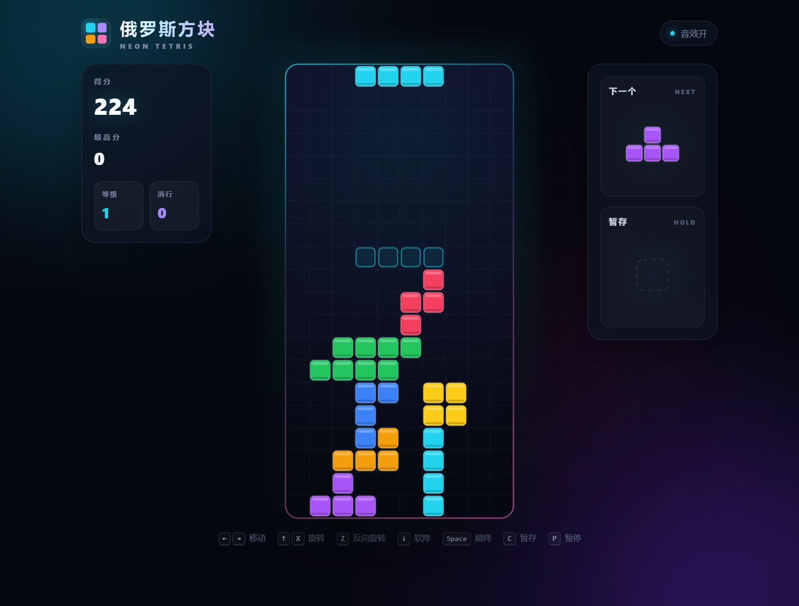

# 霓虹俄罗斯方块 · Neon Tetris

一个使用原生 HTML、CSS 和 JavaScript 编写的俄罗斯方块游戏。**单文件、零依赖**，直接用浏览器打开即可游玩，同时支持键盘与触屏操作。



## 功能

- 霓虹风格界面与方块粒子消除特效
- 标准 7-Bag 随机器，避免长时间不出某种方块
- 幽灵落点预览、暂存（Hold）与下一个方块预览
- 计分、等级加速、消行统计与最高分本地保存
- 旋转墙踢、软降与瞬降
- Web Audio 合成音效，可随时开关
- 自适应桌面和移动端布局，手机端提供触控按钮

## 操作

| 操作 | 按键 |
| --- | --- |
| 左右移动 | `←` / `→` |
| 软降 | `↓` |
| 顺时针旋转 | `↑` / `X` |
| 逆时针旋转 | `Z` |
| 瞬间下落 | `Space` |
| 暂存方块 | `C` / `Shift` |
| 暂停 / 继续 | `P` / `Esc` |
| 开始 / 重新开始 | `Enter` / `Space` |

手机端可使用棋盘下方的触控按钮。

## 本地运行

直接双击 `index.html`，或启动一个本地静态服务器：

```bash
python -m http.server 8000
```

然后访问 <http://localhost:8000>。

## 技术说明

- Canvas 2D 渲染，适配高 DPI 屏幕
- `requestAnimationFrame` 游戏循环与锁定延迟
- Web Audio API 实时生成音效，无外部音频资源
- `localStorage` 保存最高分
- 无框架、无构建步骤、无第三方运行时依赖

## 文件结构

```text
.
├── index.html    # 游戏本体
├── preview.png   # README 预览图
└── .gitignore
```

建议使用较新版本的 Chrome、Edge、Firefox 或 Safari 浏览器。
